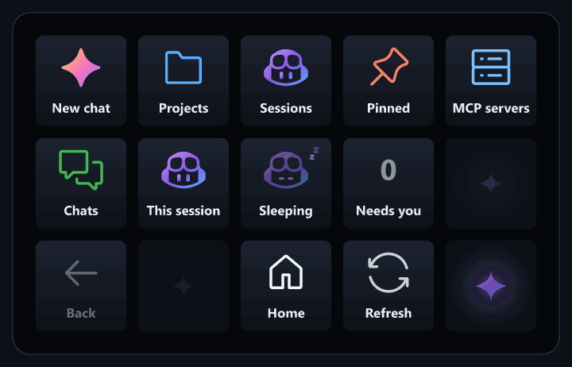
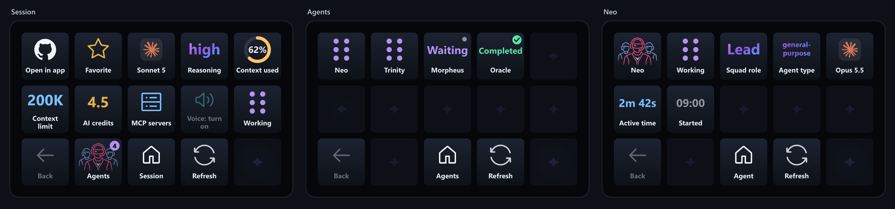

# Copilot Companion for Stream Deck

An unofficial companion for the GitHub Copilot desktop app on Windows and macOS, designed for the original 15-key Stream Deck and MK.2.

Browse your Copilot projects and sessions, see at a glance what is working and what needs you, and control a session without leaving what you're doing. It connects to the existing Copilot app, with no mouse automation and no credentials in Stream Deck.

## Highlights

- **Projects and sessions** on the deck, with sub-sessions grouped under their parent.
- **Needs you** and **Finished** keys, so a waiting or finished session is never missed.
- **A Copilot with moods** that works, sleeps, says *Psst!* and sweats when the context is nearly full.
- **Confetti** when a session finishes.
- **Push to talk** and **answer questions** straight from the keys.
- **Model, context ring and AI credits** for each session, with model switching and MCP toggles.
- **Agents** page to watch a session's subagents work.
- **Squad teams** get the Squad logo, with each agent shown by its team member name and role.

See all [features](docs/features.md).

## Quick start

1. Download `com.haflidif.copilot.streamDeckPlugin` from the [latest release](https://github.com/haflidif/copilot-stream-deck/releases/latest) and double-click it.
2. In the GitHub Copilot app, turn on **Companion device integration** (Settings, Experiments).
3. Accept the bundled profile and select **Copilot Companion** in Stream Deck.

For the optional session bridge, automatic profile switching and requirements, see [Install and set up](docs/install.md).

**Windows and macOS:** see the [setup requirements](docs/install.md#requirements) and install the optional bridge from the tag matching your plugin release.

## Documentation

| | |
| --- | --- |
| [Features](docs/features.md) | Everything the deck can do |
| [Install and set up](docs/install.md) | Requirements, the session bridge and Smart Profiles |
| [How it works](docs/how-it-works.md) | Bridges, runtimes, saved values and opening sessions |
| [Local data and permissions](docs/privacy.md) | What stays on your machine and the security model |
| [Development](docs/development.md) | Building, testing, previews and releases |
| [Integration findings](docs/integration.md) | The Copilot and Stream Deck APIs in depth |

## Contributing

Contributions are welcome, from bug reports and testing on other Stream Deck models to pull requests. Read [CONTRIBUTING.md](CONTRIBUTING.md) to get started and follow the [Code of Conduct](CODE_OF_CONDUCT.md). For help, see [SUPPORT.md](SUPPORT.md). Report security problems privately as described in [SECURITY.md](SECURITY.md).

## License

MIT, see [LICENSE](LICENSE). This project is not an official GitHub or Elgato product. Credits and trademarks are listed in [NOTICE.md](NOTICE.md).
