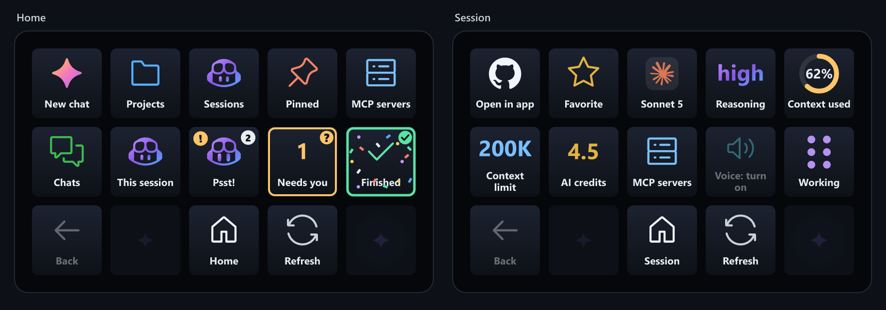
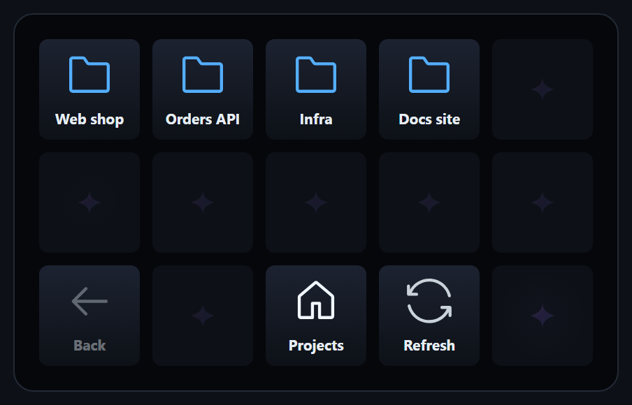
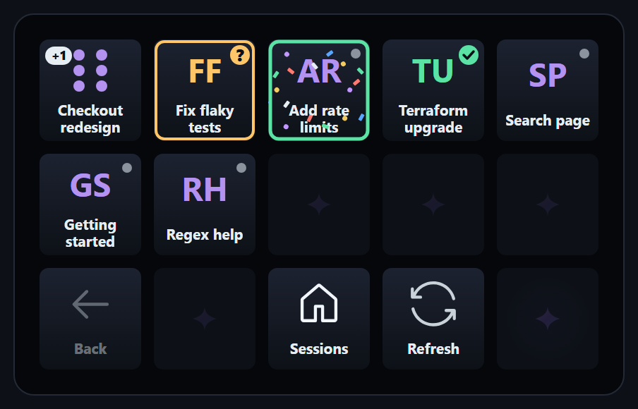
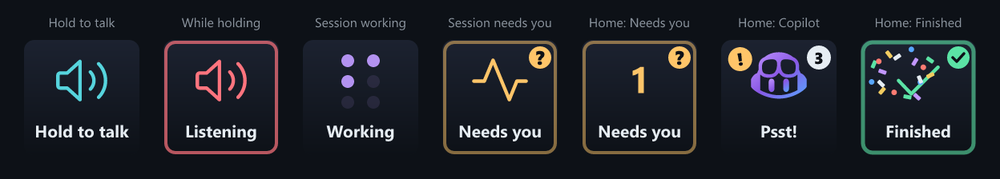
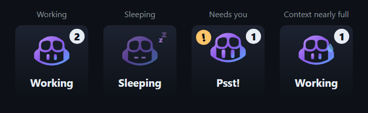
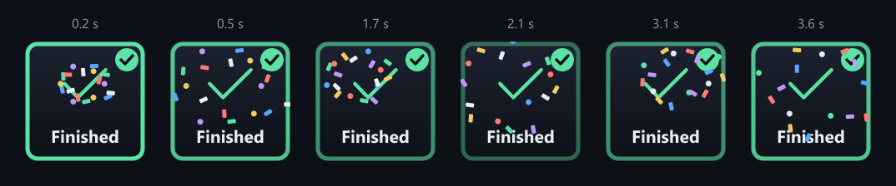

# Features

A tour of what the deck can do. The pictures use made-up demo data and are rendered with the plugin's own drawing code.

| Projects | Sessions |
| --- | --- |
|  |  |

## Layout and navigation

- A position-aware 5-by-3 dashboard with project and session browsing, paging, Back and Home.
- The bottom row is always **Back, Previous, Home/status, Refresh, Next**. The top two rows show the items. Views with up to 12 items also use the spare Previous and Next keys, so paging only starts beyond that.
- Sub-sessions (sessions another session created) are grouped under their parent. The parent key shows a "+N" pill, and pressing it lists the parent followed by its sub-sessions. The app sidebar feed has no sub-sessions, so they come from the bridge: a bridge must be running, the list is read about once a minute, and their status can lag by about five seconds. Needs you, Finished and Working still list them directly.
- Local favorites, stored in Stream Deck plugin settings, shown together with the sessions pinned in the app.
- App-wide project and session status, refreshed about every five seconds while keys are visible.

## Status at a glance

- Animated blue-dot session tiles, readable labels, attention and error indicators, and reduced motion.
- Sessions waiting for you get a pulsing amber border, and a **Needs you** home tile counts them and opens the list. If the only waiting session is open in the app with a question, it goes straight to the answers. In a session's view, the **Needs you** tile opens that session in the app, and then turns into **Answer question**.
- When a session finishes working, its tile flashes green and a **Finished** home tile takes you to it. The flash stays until you open the session on the deck, or for 5 minutes.
- Context use is shown as a ring that turns amber from 60% and red from 85%. It fills up from empty when you open a session and glides to new values as the context grows. With reduced motion it shows the value straight away.
- Empty keys run a slow sparkle wave across the deck. With reduced motion it stays still.

## Copilot moods

The Home key reacts to what is going on.

- **Working** shows an animated Copilot that looks around and blinks while sessions work, with a badge for how many are busy. Press it to list the working sessions.
- When nothing runs it turns into **Sleeping**: the Copilot dims, closes its eyes and snores a few z's.
- When a session needs you it hops with a gold "!" and says **Psst!**. Press it to jump to what needs you.
- When context passes 85%, a sweat drop runs down its head.
- When a session finishes, its key fires a few bursts of confetti before settling into the green Finished flash. This is skipped with reduced motion.

## Session controls

- Open existing sessions in the app.
- Create an idle standalone local chat after a confirmation, without starting an agent or creating a code checkout.
- Model, reasoning, context use, context limit and AI credits for the session. The Model key shows the provider logo and a short name, for example "GPT-6 Astra" or "Auto: Opus 5.5".
- **Model switching (experimental):** press the Model key to pick a model, then confirm. Auto asks for a mode first (Efficiency, Balance or Intelligence), and for other models the Reasoning key offers the levels that model supports. The change applies to the session, but the Copilot app's model picker keeps showing its old choice because it does not follow changes made outside the app. Only works for the session running the bridge.
- **MCP controls:** enable or disable MCP servers after a confirmation. For the session active in the app they use the app's own MCP list and toggle, with no bridge needed. Servers the app locks (for example by policy) are shown but cannot be changed.

## Push to talk

The mic tile on the session view uses the Copilot app's **Companion device integration** experiment (Settings, Experiments), the same local API the Logitech keypad uses. Turn it on and install the app's voice model. Hold the key to talk and release to stop. Dictation goes to the session that is active in the app window.

The same feed gives live model, reasoning, context and credits for the session open in the app window, so that session shows live values even without its bridge. This API is undocumented and may change.

With the experiment on:

- The home **This session** key becomes **Active session** and always follows the session open in the app window.
- **Open in app** switches sessions directly through the app, without a deep link.
- **New** offers **In this project** (a new session in the project the app window is showing) or **New chat** (a standalone chat, through the bridge).

## Answer questions

When the session open in the app window is waiting on a question, the free home key next to Needs you turns into a pulsing **Answer question** key. Press it to get one key per choice (the app only shares the start of each label), plus **Type answer** when free text is allowed, which moves focus to the app's answer box. A choice is sent as soon as you press it. This uses the same companion API.

## Monitor subagents

From **v0.2.0**, open **Active session** (or any session) and press **Agents**, the bottom-row key next to **Back**. The key shows how many subagents the session has, and its icon pulses while any of them is working.

The Agents page lists the session's runtime subagents, with animated **Working** tiles and separate **Waiting**, **Completed**, **Failed** and **Cancelled** states. Press an agent for its status, type, model and active time when the runtime provides them. The view is read-only.

This needs the session bridge and a Copilot runtime that exposes the experimental task-list API. See [How it works](how-it-works.md#subagents) for the details.

## Not connected yet

- Pinning or unpinning from the deck.
- Model selection for sessions without a running bridge.
- MCP control for sessions that are neither active in the app nor running a bridge.
- Squad-specific roster roles and standalone Squad CLI connections.

Unavailable features are clearly marked on the deck. Idle does not mean completed. The [integration findings](integration.md) have the complete feature matrix and remaining work.
